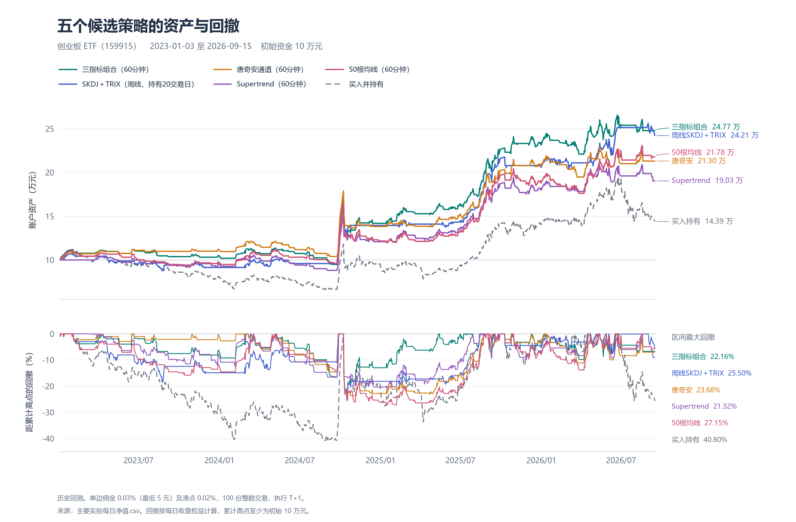
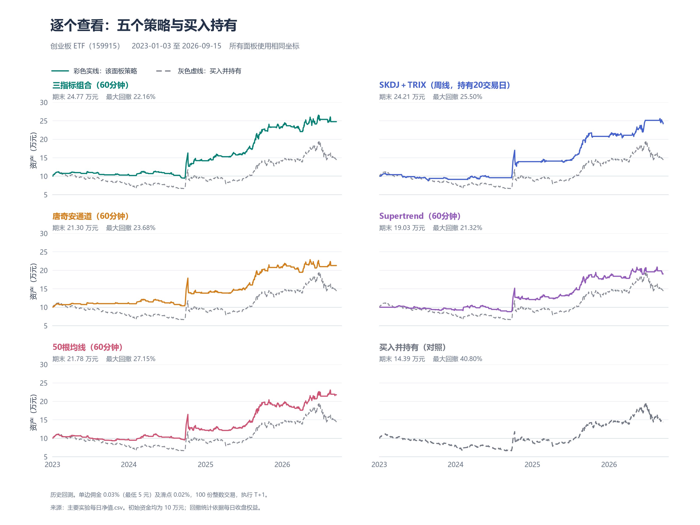
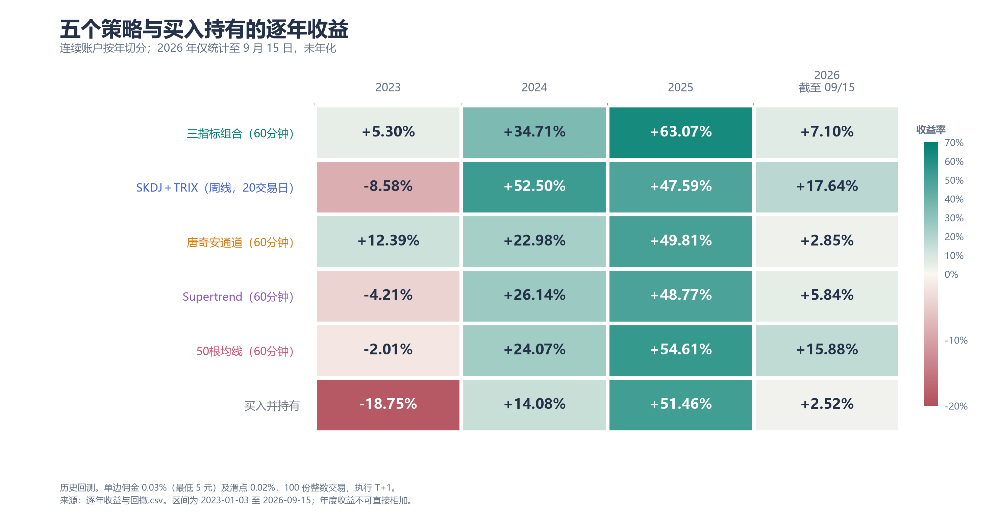

# 创业板多周期策略研究与模拟交易应用报告

研究冻结日 2026年9月16日    行情截至 2026年9月15日

本报告汇总创业板ETF 159915的15套指标规则、六种信号周期及22种固定组合的历史研究，并说明五个候选策略如何进入后续模拟交易观察。核心比较采用同一只ETF、同一账户规则与同一日期区间。

在2023年1月3日至2026年9月15日的共同区间内，先要求至少10笔完整交易，再按年化收益与最大回撤之比排序，得到下列五个候选。三指标60分钟组合的该比值最高，为1.254；周线SKDJ＋TRIX其次，为1.058。这是本次历史筛选结果，后续仍需持续记录未见数据。

| 共同区间候选 | 年化收益 | 最大回撤 | 年化回撤比 | 完整交易 | 期末万元 |
| --- | --- | --- | --- | --- | --- |
| 三指标组合 60分钟 | 27.79% | 22.16% | 1.25 | 90 | 24.77 |
| SKDJ＋TRIX 周线 | 26.99% | 25.50% | 1.06 | 19 | 24.21 |
| 唐奇安 60分钟 | 22.67% | 23.68% | 0.96 | 48 | 21.30 |
| Supertrend 60分钟 | 18.99% | 21.32% | 0.89 | 45 | 19.03 |
| 50根均线 60分钟 | 23.42% | 27.15% | 0.86 | 99 | 21.78 |
| 买入并持有 | 10.34% | 40.80% | 0.25 | 1 | 14.39 |

### 结论的使用范围

每项独立实验初始资金为10万元。五个候选既包含长期趋势过滤，也包含固定持有时钟，交易节奏与风险来源不同。共同区间三指标组合的年化收益为27.79%，额外延迟一根60分钟执行后降为19.29%；周线SKDJ＋TRIX从26.99%降为14.36%。因此，基准收益不能脱离参数和执行条件单独使用。

原周线SKDJ＋TRIX曾以既有历史选参；本轮五候选又由已知历史表现筛选。所有收益均已计入设定费用，均不代表可保证的未来收益或真实成交结果。

阅读顺序建议为研究设计、规则定义、分组结果、候选与图形、敏感性、审计和应用说明。完整逐笔交易与全部实验保留在配套CSV、工作簿和冻结证据包中。

## 一 研究设计与冻结数据

研究以单一创业板ETF的择时为对象，只允许持有ETF或现金。15套基础规则分别在60分钟、120分钟、日、周、双周和月线计算，共90种规则周期配置；另设18种同周期投票组合和4种跨周期共振，共22种组合配置。

| 比较组 | 起始日 | 截至日 | 实验数 | 主要用途 |
| --- | --- | --- | --- | --- |
| 长期公平比较 | 2017-01-03 | 2026-09-15 | 76 | 日周双周月充分预热后比较 |
| 2013起观察 | 2013-01-04 | 2026-09-15 | 76 | 保留预热等待现金的早期历史 |
| 六周期共同区间 | 2023-01-03 | 2026-09-15 | 113 | 六种周期使用同一60分钟账本 |
| 长期敏感性 | 2019-01-02 | 2026-09-15 | 249 | 基础与相邻参数都完成预热 |
| 共同区间敏感性 | 2023-01-03 | 2026-09-15 | 373 | 覆盖90配置的扰动检查 |

887次主账户回放之外，另有93次单项末段换源实验及106次组合稳健性诊断，合计1086次回放。这些次数包含重复基准、不同区间及同一规则的扰动，不等于1086套互不相关的策略。

### 真实可用的数据范围

| 数据 | 冻结覆盖 | 数量 | 用途 |
| --- | --- | --- | --- |
| 腾讯日线 | 2011-12-09 至 2026-09-15 | 3586日 | 日线及以上周期信号和长期执行 |
| 新浪60分钟 | 2022-08-17 至 2026-09-15 | 3960根 990日 | 盘中信号及六周期共同执行 |
| 共同区间每日权益 | 2023-01-03 至 2026-09-15 | 898交易日 | 五候选曲线与每日收盘回撤 |

未取得2022年8月17日以前可用的完整分钟历史，因而没有把2013年起日线结果与分钟结果混排。主日线采用未复权真实报价；前复权价逐项对照最大差为0。上市后的公开分红页未见分红，上市前折算不另计为账户收益。相关证据不能替代基金官方全部公司行动档案。

## 二 指标规则与预热 上

下表参数均按输入K线的根数计算，适用于六种信号周期；例如60分钟SMA20和月线SMA20的日历跨度不同。交叉规则要求本根及前一根都已完成预热，状态规则只使用当时已知数值。

| 编号 | 规则 | 基础参数 | 预热根数 | 入场与退出 |
| --- | --- | --- | --- | --- |
| 1 | SKDJ波段 | N9 M3 | 18 | K上穿D买入，下穿D卖出。 |
| 2 | TRIX趋势 | EMA12 信号SMA9 | 45 | TRIX上穿信号线买入，下穿卖出。 |
| 3 | MACD | EMA12与26 DEA9 | 35 | DIF上穿DEA买入，下穿卖出。 |
| 4 | 双均线 | SMA20与60 | 60 | 快线上穿慢线买入，下穿卖出。 |
| 5 | RSI强弱趋势 | Wilder14 阈值50 | 43 | RSI上穿50买入，下穿50卖出。 |
| 6 | 布林带突破 | SMA20 2倍标准差 | 20 | 收盘上穿上轨买入，下穿中轨卖出。 |
| 7 | DMI与ADX | DMI14 ADX14 门槛25 | 56 | ＋DI＞－DI且ADX≥25持有，否则退出。 |
| 8 | 唐奇安突破 | 入场20 退出10 | 21 | 收盘突破此前20根高点买入，跌破此前10根低点卖出。 |

### SKDJ和TRIX的具体约定

SKDJ以N根最高最低价构造RSV，连续两次EMA(M)得到K，再以K的M根简单均值得到D，不计算普通KDJ的J线。TRIX为收盘价三次EMA后的一根变化率，信号线用简单均值。MACD的DEA使用EMA，不能把TRIX与MACD的信号线类型混用。

平滑层以首个有效值起算，预热门槛统一由ready状态控制。窗口不足时不得用早期数值开仓。高低区间为零时SKDJ沿用前一个原始RSV，无前值时取50。

## 三 指标规则与预热 下

| 编号 | 规则 | 基础参数 | 预热根数 | 入场与退出 |
| --- | --- | --- | --- | --- |
| 9 | ROC动量 | 20根 阈值0 | 21 | ROC＞0持有，否则退出。 |
| 10 | CCI强势 | 20根 入100 出0 | 20 | CCI上穿100买入，下穿0卖出。 |
| 11 | OBV量能趋势 | OBV及SMA20 | 20 | OBV上穿其均线买入，下穿卖出。 |
| 12 | Supertrend | Wilder ATR10 倍数3 | 30 | 趋势由空转多买入，由多转空卖出。 |
| 13 | RSI超跌反转 | Wilder14 入30 出70 | 43 | RSI＜30买入，＞70卖出，中间保持。 |
| 14 | 50根均线择时 | SMA50 | 50 | 收盘＞均线持有，否则退出。 |
| 15 | SKDJ与TRIX定时持有 | SKDJ3与5 TRIX4与8 | 20 | K＞D且TRIX＞信号线时入场，固定20个交易日后退出。 |

### 容易影响复现的公式细节

RSI、ATR、DMI和ADX采用Wilder平滑，以最初N个有效数值的算术均值播种，后续使用1/N的更新权重。布林带使用总体标准差，ddof为0。CCI使用典型价的平均绝对偏差，而不是标准差。

唐奇安高低通道先后移一根，排除当前信号K线自身高低价。OBV按收盘涨跌增减当根成交量，单位必须在整个样本内一致。Supertrend以HL2加减ATR倍数构造带宽，最终上下轨按前收盘和前趋势逐根收紧或切换。

第15套的持有期限始终是20个交易日，既不是20根分钟K线，也不是20周。买入日计为第1日，第20日收盘发出时间退出指令，第21个交易日开盘执行；期末强制清算可能提前结束最后一笔。持有期间不因指标转空提前退出。

固定相邻参数通常把回看长度增加约20%，布林带和Supertrend倍数增加10%；阈值不事后搜索。完整基础与邻近参数以及各周期首次ready日期，见全部周期参数与预热.json。

## 四 六种周期与组合规则

| 周期 | 合成与完成判断 | 执行要求 |
| --- | --- | --- |
| 60分钟 | 10:30 11:30 14:00 15:00为结束时间 | 完成后最早下一根基础K线开盘 |
| 120分钟 | 上午两根与下午两根分别合并 | 不得跨午休或跨日错配 |
| 日线 | 完整交易日的日线 | 本组基础账本决定次一可执行开盘 |
| 周线 | 按实际交易日历确认完整周 | 节假日短周可在最后交易日确认 |
| 双周线 | 以2011-12-05周一为固定锚点 | 首尾不完整周期剔除 |
| 月线 | 已完成月份，按交易日历确认 | 未完成本月不得提前生效 |

240分钟覆盖一个交易日，本轮使用日线档，不另算一种独立周期。长期组在日线账本执行，共同区间全部规则统一在60分钟账本执行，保持同组交易网格一致。

| 组合家族 | 成员与门槛 | 数量 |
| --- | --- | --- |
| 六指标普通投票 | SKDJ、MACD、双均线、RSI趋势、唐奇安、OBV；至少4票入场，少于3票退出 | 6 |
| 六指标严格投票 | 同六指标；至少5票入场，少于3票退出 | 6 |
| 均线突破量能组合 | 双均线、唐奇安、OBV；至少2票持有，否则现金 | 6 |
| 日周均线共振 | 日与周的双均线意图均为多头 | 1 |
| 日周月MACD共振 | 三个周期中至少2票 | 1 |
| 周月50根均线共振 | 周与月均为多头 | 1 |
| 60与120分钟及日均线共振 | 三个周期中至少2票，仅共同区间比较 | 1 |

投票以每个成员当时已知的持仓意图计算。指标完成交叉入场后持续记为多头，直到出现自身退出；它不是要求各成员在同一根K线上同时发出新金叉。组合规则先固定，再计算绩效。

## 五 九十种基础配置的共同区间年化收益

以下90个单项规则周期配置全部使用2023-01-03至2026-09-15、初始10万元和同一60分钟执行网格。表内未按交易次数过滤，也未把组合混入。完整回撤、交易次数与逐笔记录需同时阅读。

| 指标规则 | 60分钟 | 120分钟 | 日线 | 周线 | 双周线 | 月线 |
| --- | --- | --- | --- | --- | --- | --- |
| SKDJ | 3.20% | 7.72% | -1.09% | 3.99% | -4.08% | -10.00% |
| TRIX | 0.13% | 1.62% | 6.44% | -4.42% | -16.43% | 12.61% |
| MACD | -3.03% | 10.41% | 12.85% | 0.80% | -8.26% | 5.50% |
| 双均线 | 13.01% | 9.75% | -0.14% | 11.19% | 15.16% | 0.16% |
| RSI趋势 | 18.34% | 15.97% | 12.26% | 9.29% | 2.00% | 1.58% |
| 布林带 | 15.88% | 9.98% | 15.21% | -3.44% | -3.83% | 3.45% |
| DMI与ADX | 18.52% | 17.27% | 12.26% | 7.05% | 3.54% | -0.40% |
| 唐奇安 | 22.67% | 11.16% | 7.25% | 3.75% | -4.38% | 3.45% |
| ROC | 12.65% | 18.60% | 0.99% | 5.34% | 0.46% | 14.76% |
| CCI | 11.75% | 12.75% | 12.21% | -4.44% | 2.04% | 12.61% |
| OBV | 5.75% | 11.33% | 10.98% | 8.69% | 8.86% | -3.11% |
| Supertrend | 18.99% | 7.64% | 8.06% | 11.23% | 5.50% | 5.50% |
| RSI反转 | -5.22% | -2.89% | -4.22% | 13.71% | 9.01% | 22.27% |
| SMA50 | 23.42% | 12.12% | 13.85% | 10.70% | 2.15% | 8.03% |
| SKDJ与TRIX定时 | 6.74% | 4.51% | 6.55% | 26.99% | -1.38% | -7.71% |

同期买入并持有的年化收益为10.34%，最大回撤为40.80%，期末资产为14.39万元。

### 周期差异只能在本组规则内解释

共同区间单项年化中位数分别为60分钟12.65%、120分钟10.41%、日线8.06%、周线7.05%、双周线2.00%、月线3.45%。这描述本轮规则在该段历史的分布，不能推导为分钟线普遍优于月线。月线RSI反转的22.27%年化仅来自1笔完整交易，不能与几十笔交易的策略视为同样充分的样本。

## 六 长期结果与五个候选的筛选

长期公平比较从2017年1月3日开始，覆盖日、周、双周和月线；不包括没有对应真实历史的分钟策略。下表为单项年化前七名，保留小交易样本，不把它们直接转成候选推荐。

| 周期和规则 | 年化收益 | 最大回撤 | 完整交易 |
| --- | --- | --- | --- |
| 周线 SKDJ＋TRIX固定持有20交易日 | 21.04% | 25.50% | 53 |
| 月线 TRIX趋势 | 13.58% | 25.68% | 2 |
| 周线 双均线 | 10.92% | 38.56% | 2 |
| 双周线 双均线 | 10.74% | 39.61% | 2 |
| 月线 CCI强势 | 9.86% | 31.69% | 2 |
| 日线 50根均线择时 | 8.32% | 33.07% | 73 |
| 月线 MACD金叉死叉 | 8.15% | 44.98% | 2 |

长期同期买入持有年化5.84%、最大回撤56.58%。周线SKDJ＋TRIX在长期组年化21.04%、最大回撤25.50%，共有53笔完整交易；其已知历史选参背景仍需保留。交易次数只有2笔的月线或双周结果，可能主要反映少数持仓区间。

### 筛选规则与候选范围

候选从共同区间112个非基准配置中选择。要求至少10笔完整交易且最大回撤大于0后，剩余59个配置；随后按“年化收益 ÷ 最大回撤”从高到低排序，前五即三指标60分钟组合、周线SKDJ＋TRIX、唐奇安60分钟、Supertrend60分钟与50根均线60分钟。

该比值使用同一区间年化和每日收盘最大回撤，便于比较收益相对于历史回撤的大小；它不包含未来回撤概率、回撤持续时间和行情供应商不确定性。至少10笔只是最低筛查线，也不保证统计充分。

五候选是在查看本轮历史结果后筛选出来的，因此应从规则冻结后的新增行情继续积累观察。模拟交易App用于持续展示和记录，不应把历史排名写成固定收益承诺。

## 七 三个候选的可执行规则

### 三指标组合 60分钟

双均线使用SMA20与SMA60；唐奇安使用此前20根最高价和此前10根最低价；量能项为OBV与其SMA20。各成员独立保存自己的多空意图，三票中至少两票为多头时请求持有，少于两票请求退出。未完成60分钟K线不得改变正式状态。

这是同一只ETF的信号投票，不是三种资产分散配置。共同区间完整交易90次，T+1退出延期21次。胜率38.89%仍取得较高收益，说明不能只用胜率替代整体盈亏结构。

### SKDJ与TRIX 周线

在已完成周线上计算SKDJ(3,5)与TRIX(4,8)。空仓时K＞D且TRIX高于其简单信号线即可请求入场，不要求当周恰好新金叉。实际买入日开始计时，固定持有20个交易日，按时间退出；期间不因死叉提前卖出。

周线第15套来自旧历史搜索参数，其他周期是新研究变体。共同区间19笔完整交易，年化26.99%、最大回撤25.50%；相邻参数显著降低结果，不能只引用基础参数的成绩。

### 唐奇安通道 60分钟

当完整60分钟K线收盘严格高于此前20根的最高价时请求入场，严格低于此前10根最低价时请求退出。通道明确排除当前K线高低价。若既未上破也未下破，延续原持仓意图。

基础预热需21根完整K线。共同区间48笔完整交易，年化22.67%、最大回撤23.68%；固定相邻通道24/12下年化22.31%，具体成本与延迟结果见敏感性表。

上述所有请求都要再经过统一执行账本。信号成立不等于以信号收盘价成交。

## 八 其余候选与统一交易时点

### Supertrend 60分钟

使用Wilder ATR10及3倍波动带，以高低价中点HL2构造基础上下轨，按前收盘与前趋势递推最终轨道。由空转多请求买入，由多转空请求退出；使用30根完整K线预热。共同区间45笔完整交易，年化18.99%、最大回撤21.32%。

Supertrend公式在不同平台存在初始化和平滑差异。复现时必须沿用本轮Wilder播种、最终带递推和初始空头状态，不能只在其他软件选择同名指标后默认数值相同。

### 50根均线 60分钟

以50根完整60分钟收盘价计算简单均线。收盘高于均线时请求持有，否则退出。这里是50根60分钟K线，约12.5个完整交易日的根数尺度，不是50日或50周。

共同区间99笔完整交易，年化23.42%、最大回撤27.15%，T+1退出延期33次。延迟一根60分钟执行后年化降为15.13%、回撤升至34.00%，需要重点观察实际信号到成交的等待。

### 统一执行与账户规则

| 项目 | 实际采用的口径 |
| --- | --- |
| 成交时点 | 完成K线确认后，最早下一根基础K线开盘；共同区间基础K线为60分钟。 |
| T+1 | 当日买入不得当日卖出；退出指令保留到下一交易日，不因其间恢复多头而自动撤销。 |
| 资金与数量 | 初始100000元，只做多，无杠杆，100份整数交易；现金不计利息。 |
| 成本 | 单边佣金0.03%，最低5元，四舍五入到分；单边滑点0.02%。 |
| 期末处理 | 末交易日不再开新仓，余仓按最后收盘扣费清算；期末清算不是交易信号。 |

主回撤依据每日收盘权益；另保存基础K线收盘回撤。平均仓位为K线收盘市值权重均值，不等于精确持仓时间百分比。

## 九 五个候选的资产与回撤

共同区间2023-01-03至2026-09-15，六条曲线各898个交易日。曲线与统计来自同一冻结账户结果。

## 十 五个候选分别与买入持有比较

共同区间2023-01-03至2026-09-15，六条曲线各898个交易日。曲线与统计来自同一冻结账户结果。

## 十一 五个候选的逐年收益

逐年收益来自同一连续账户，2026年仅截至9月15日，未年化；各年收益不可直接相加。

## 十二 五个候选的敏感性

以下均为共同区间，保留预先固定的基础版本。成本翻倍同时将佣金提高至0.06%、滑点提高至0.04%，最低佣金仍5元；延迟是在原执行映射之后额外等待一根60分钟。

| 候选 | 版本 | 年化收益 | 最大回撤 | 完整交易 |
| --- | --- | --- | --- | --- |
| 三指标组合 60分钟 | 基准 | 27.79% | 22.16% | 90 |
| 三指标组合 60分钟 | 成本翻倍 | 24.71% | 22.21% | 90 |
| 三指标组合 60分钟 | 相邻参数 | 23.47% | 22.17% | 81 |
| 三指标组合 60分钟 | 延迟60分钟 | 19.29% | 23.28% | 91 |
| SKDJ＋TRIX 周线 | 基准 | 26.99% | 25.50% | 19 |
| SKDJ＋TRIX 周线 | 成本翻倍 | 26.33% | 25.49% | 19 |
| SKDJ＋TRIX 周线 | 相邻参数 | 10.47% | 28.88% | 18 |
| SKDJ＋TRIX 周线 | 延迟60分钟 | 14.36% | 33.67% | 23 |
| 唐奇安 60分钟 | 基准 | 22.67% | 23.68% | 48 |
| 唐奇安 60分钟 | 成本翻倍 | 21.10% | 23.80% | 48 |
| 唐奇安 60分钟 | 相邻参数 | 22.31% | 22.18% | 39 |
| 唐奇安 60分钟 | 延迟60分钟 | 19.46% | 24.62% | 48 |
| Supertrend 60分钟 | 基准 | 18.99% | 21.32% | 45 |
| Supertrend 60分钟 | 成本翻倍 | 17.56% | 21.65% | 45 |
| Supertrend 60分钟 | 相邻参数 | 22.22% | 20.76% | 39 |
| Supertrend 60分钟 | 延迟60分钟 | 24.05% | 21.98% | 45 |
| 50根均线 60分钟 | 基准 | 23.42% | 27.15% | 99 |
| 50根均线 60分钟 | 成本翻倍 | 20.14% | 27.96% | 99 |
| 50根均线 60分钟 | 相邻参数 | 20.90% | 25.50% | 89 |
| 50根均线 60分钟 | 延迟60分钟 | 15.13% | 34.00% | 103 |

周线固定持有期限改为18或22个交易日时，年化分别为14.78%和19.14%。Supertrend的相邻和延迟版本在本段历史中高于基准，也不应事后替换成“主参数”。完整22组合的四版本检查是看到基准后追加的诊断，不是独立未来验证。

## 十三 换源诊断与数据局限

分钟供应商口径是实际限制。新浪分钟聚合OHLC在990日中有976日与腾讯日线一致，另14日的个别价格差为0.001至0.003元；日成交量差的绝对最大值约9.06%。OBV依赖成交量，因此组合与量能策略必须保留这一限定。

末段换源检查使用新浪历史作为共同预热底稿，再以腾讯或东方财富实际可覆盖的末段替换并重新计算。比较区间为2026-08-05至2026-09-15，共30个交易日，以下仅展示累计收益和回撤，不年化。

| 候选 | 行情版本 | 累计收益 | 最大回撤 |
| --- | --- | --- | --- |
| 三指标组合 60分钟 | 新浪原始 | 0.89% | 4.94% |
| 三指标组合 60分钟 | 腾讯替换末段 | 0.86% | 4.94% |
| 三指标组合 60分钟 | 东财替换末段 | 0.86% | 4.94% |
| 唐奇安 60分钟 | 新浪原始 | 0.75% | 4.94% |
| 唐奇安 60分钟 | 腾讯替换末段 | 0.72% | 4.94% |
| 唐奇安 60分钟 | 东财替换末段 | 0.72% | 4.94% |
| Supertrend 60分钟 | 新浪原始 | -4.26% | 4.26% |
| Supertrend 60分钟 | 腾讯替换末段 | -4.14% | 4.14% |
| Supertrend 60分钟 | 东财替换末段 | -4.14% | 4.14% |
| 50根均线 60分钟 | 新浪原始 | 4.16% | 6.53% |
| 50根均线 60分钟 | 腾讯替换末段 | 4.19% | 6.50% |
| 50根均线 60分钟 | 东财替换末段 | 4.19% | 6.50% |

三指标组合在腾讯与东方财富末段替换下，累计收益较新浪均低约0.0287个百分点。差异很小只适用于该30交易日段，不能据此证明四年分钟行情全部准确。周线候选不在这一分钟信号换源列表内。

没有补造更早盘中数据，没有把缺失的成交额写成0，也未用日线高低价擅自修正分钟柱。ETF公开分红与折算资料、价格复权对照和供应商原始响应均随冻结证据保留。

## 十四 风险解释与独立审计范围

### 从历史结果可以确认的内容

五个候选的共同区间收益和回撤来自统一账本，费用、整百份交易、T+1和期末清算均有记录。三组走势图逐项核对了六个案例的898日权益、终值、含初始10万元高点的回撤，以及24个年度收益，结果一致。

| 核查层级 | 已完成的覆盖 | 不能扩大解释的范围 |
| --- | --- | --- |
| 逐笔与终值核查 | 887案例 26799笔完整交易 | 覆盖交易约束和资金恒等，不等于独立实现全部指标。 |
| 固定持有与清算 | 2805笔非期末定时退出 281笔期末清算 | 按18 20 22交易日和末收盘分别核对。 |
| 独立Decimal账本 | 28代表案例 86715根基础K线 | 逐根现金持仓权益重放，其余敏感性未全部导出逐bar账本。 |
| 最终引擎复现 | 8代表案例与存档完全一致 | 使用原指标库与模拟器，是版本复现而非独立公式实现。 |
| 指标边界 | 30组参数接口检查 210个前缀检查 | 另有平价及涨跌边界测试，不能证明供应商数据正确。 |
| SKDJ和TRIX对照 | 与旧版函数有效数值逐项一致 | 绝对及相对容差1e-12，不能自动等同旧报告执行口径。 |

### 仍然未解决的限制

研究没有完整模拟开盘排队、涨跌停可成交概率、订单冲击、最小报价档位与账户容量。每日收盘回撤也不等于真实盘中最大损失。历史价格能够找到，并不保证真实订单能按该价成交。

参数、规则家族、比较区间和最终候选均建立在已经存在的行情历史上。不能把分段表现、相邻参数检查、同一引擎重放或审计通过称为从未见过的未来样本外结果。小交易样本和共同市场行情造成的相关性，也会降低直观排名的稳定性。

## 十五 来源与复现方法

所有研究数值均从冻结文件重新读取，报告不重新优化参数。数值引用的优先级为机器可读结果、逐笔与每日权益、对应的规则说明和审计记录；展示值按所示精度四舍五入。

| 配套证据 | 主要用途 |
| --- | --- |
| 全部策略周期结果.csv | 887个主案例的参数版本、区间、收益、回撤和交易指标 |
| 全部逐笔交易.csv | 26799笔完整交易的时间、价格、费用和盈亏 |
| 主要实验每日净值.csv | 265个主曲线案例的每日权益，供曲线与年度对照 |
| 逐年收益与回撤.csv | 连续账户分年的收益与回撤 |
| 组合敏感性.csv 与 盘中数据源敏感性.csv | 106个组合诊断与93个单项换源结果 |
| 预先固定的实验方案.json 与 全部周期参数与预热.json | 参数、组合门槛及预热证据 |
| 独立复核报告.md 与 json | 审计覆盖、输入哈希、代表案例和复现结果 |
| 离线复现与完整证据.zip | 规范行情、原始响应、代码、冻结参数和核验账本 |

### 公开数据与规则来源

腾讯行情接口 https://proxy.finance.qq.com/ifzqgtimg/appstock/app/newfqkline/get

新浪行情接口 https://money.finance.sina.com.cn/quotes_service/api/json_v2.php/CN_MarketData.getKLineData

东方财富行情接口 https://push2his.eastmoney.com/api/qt/stock/kline/get

基金官方资料 https://static.efunds.com.cn/html/fund/159915_fundinfo.htm

分红折算资料 https://fundf10.eastmoney.com/fhsp_159915.html

深交所ETF交易说明 https://investor.szse.cn/warning/activities/fundIntroduction/t20210104_584079.html

### 离线重算

在冻结包内运行run_research.py重建887主实验；source_sensitivity.py与combo_sensitivity.py重建补充诊断；audit_engine.py与audit_real_results.py复核账本。prepare_data.py仅使用--normalize-only时按冻结响应重建，重新联网抓取属于新实验。工作簿是静态快照，改Excel单元格不会重跑策略。

日线SHA256 6bd13a609916090d9bd4812224325994de660825219ec9accb4aa02df551ccb6

60分钟SHA256 81e539793156cfa773d36ee152fe9f601506033e21e7f139156f79223eadb916

## 十六 简明ETF模拟交易App的策略扩展

简明ETF模拟交易App v1.2在现有程序中增加“创业板优选 · 5策略”页，包含“已确认信号”“五策略历史对比”和“创业板模拟账户”。五个研究候选使用本报告冻结的规则与参数，供后续持续观察和模拟记账。

交付版本 1.2，继承1.1.3的原九策略、排名标签及界面修复

| 新增能力 | 实际行为 |
| --- | --- |
| 已确认信号 | 真实60分钟行情每30分钟自动刷新，也可手动刷新；仅使用完成K线并显示其时间。周线按截至2026-12-31的官方交易日历确认，刷新失败保留旧数据。 |
| 五策略历史对比 | 同时比较五策略与买入持有。默认从2023-01-03至最后完整交易日，本金可选，展示资产和回撤图，并可导出JSON。 |
| 持续模拟账户 | 创建时固定策略，按后续完整K线接续；执行100份整数交易、T+1和本报告费用，持续模式保留持仓，不因每次计算到末日而清仓。 |
| 账户导出与恢复 | 导出ZIP，导入为独立副本；重复接续不重复记账。原profile位置保留，新模块使用“创业板优选”子目录。 |
| 原功能与报告入口 | 保留原9策略、原ENGINE账本、排名标签及1.1.3界面修复：末日模拟按钮防误启用，无效本金清空旧盘中方案。程序优先打开EXE同目录的“创业板策略研究与应用报告.pdf”，另附可编辑MD。 |

### 软件验证

| 检查 | 已验证结果 |
| --- | --- |
| 研究基准一致性 | 五候选与买入持有共六条研究基准完全匹配。 |
| 原9策略兼容 | 资金、持仓、曲线和成交与既有1.1.2校验基准完全一致；继承1.1.3界面修复未改变策略或财务引擎。 |
| 持续账户与输入 | 重复接续、导出导入恢复通过；26组非法输入均未改变落盘状态。 |
| 界面与正式EXE | 界面显示5行信号、6行比较及原策略排名。正式v1.2 EXE自检通过，研究匹配、账户重复接续及5个信号均验证成功。 |
| 正式EXE联网刷新 | 实际新增3根60分钟行情，截至2026-09-16 14:00；完整日线仍截至2026-09-15，未完成日线与分钟柱已剔除。 |

研究对比按期末收盘清算以统一统计，持续模拟账户则保留未触发退出的持仓；两者在观察截止时点的账面资产与交易笔数可能不同。读取信号时应同时检查行情完成时间。

程序入口 简明ETF模拟交易_v1.2.exe
